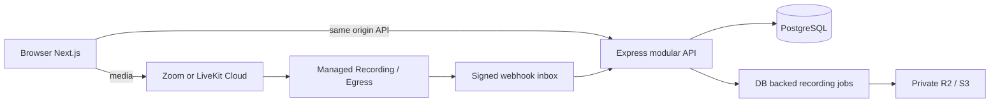

# 아키텍처와 기술 결정

기준: [Lesora_plan.md](../Lesora_plan.md), 갱신일 2026-11-04. 사용자 제공 제안을 검토하여 기준 문서를 v0.3으로 보강했다. 이 문서는 실행 설계이며 충돌 시 기준 문서를 우선한다.

## 현재 상태와 범위

초기 폴더에는 계획서만 있었고 Git 저장소, 코드, AGENTS.md는 없었다. 사용자·과목·브랜드와 무관한 공통 수업을 중심으로 설계한다. 이번 구현은 Phase 0의 로컬 PoC 기반이다. 사용자 인증, DB 저장, 채팅, 자동 녹화, 다시보기는 아직 서비스 구현이 아니다. `packages/core/src/recording.ts`는 상태 전이 계약일 뿐 녹화 오케스트레이터가 아니다.

기준 문서의 자동 녹화 필수 조건은 유지한다. Phase 0에서 실제 녹화 E2E를 검증하고 Phase 2에서 운영 기능으로 완성한다. Phase 1만으로 외부 서비스 출시를 완료했다고 판단하지 않는다. 계획서 12장의 미결정 항목은 자동 녹화 필수 원칙하에서 동의 거부 시 수업 제공 정책을 정하는 것이다.

## 선택과 근거

| 영역 | 초기 선택 | 이유와 한계 |
|---|---|---|
| 웹 | Next.js App Router / React / TypeScript | 계획서 우선. SDK는 클라이언트에서 선택 시 동적 import, 기본 화면에서 양 SDK 실행 금지. Next의 최소 브라우저 범위와 RTC 지원 범위 교집합을 시험한다. |
| UI | Tailwind CSS 4 + 작은 기본 CSS | 화면 라이브러리 추가 없이 접근 가능한 기본 제어 UI. |
| API | Express 5, 모듈형 단일 앱 | 현재 규모에서 NestJS의 DI/데코레이터 설정보다 구성 단순성 우선. 요청 검증/권한/공급자 모듈을 분리하여 확대한다. NestJS 전환은 필수 아님. |
| 런타임 | Node 24.11.0 | 로컬 설치 버전과 일치. API는 Node의 타입 제거로 TS 실행; 타입 검사는 별도 tsc. 배포 전 최신 보안 패치 검토. |
| DB | PostgreSQL 17 | 관계·트랜잭션·멱등 제약에 적합. Phase 0는 Compose 컨테이너 정의만 제공하며 앱 연결/마이그레이션은 Phase 1. |
| RTC | Zoom / LiveKit 모두 후보 유지 | 수신·렌더링·권한·녹화 모델이 다름. 실측 전 최종 선정 금지. |
| 저장 | S3 또는 R2 미결정 | Zoom BYOS 호환성, 이관 비용, 보관 정책을 확인 후 결정. |
| 프록시 | Caddy 제안 | TLS 설정이 간단. 현재 로컬에서는 Next rewrite로 동일 출처 API. Caddy 예제만 제공, 외부 노출 안 함. |
| 배포 | npm workspaces + Docker Compose | Turborepo/Redis/Kubernetes 없이 web/api/db. 녹화 인코딩은 공급자 관리형. |
| 공동 편집 | Monaco/Yjs/Hocuspocus, Phase 3 | 코딩 워크스페이스에서만 로드. ShareDB는 계획서 7.5절의 조건부 대안이며 현재 우선안과 의존성은 교체하지 않음. |

Next/React/Express/Tailwind/TypeScript는 MIT 계열, LiveKit JS SDK는 Apache-2.0, PostgreSQL은 PostgreSQL License, Caddy는 Apache-2.0을 기준으로 검토한다. Zoom SDK는 MIT 대체재가 아니라 배포 패키지의 LICENSE 및 서비스 약관 적용 대상이다. 의존성 설치 후 전이 의존성까지 라이선스·취약점 목록을 재검토한다. 최신 공식 문서는 지속적으로 바뀌므로 버전 핀과 검증 결과를 함께 유지한다. 현재 네트워크 제한으로 lockfile과 실제 설치 패키지 라이선스 검증은 미완료다.

## 배치 구조



위 그림은 목표 구조다. 현재 구현은 웹/토큰 API/브라우저 어댑터이고 DB 이후 흐름은 설계다. 향후 jobs는 같은 배포 내 별도 프로세스로 실행할 수 있으며 작업량이 커지기 전 Redis 큐는 추가하지 않는다.

```text
apps/web/app/             라우팅, 전역 스타일
apps/web/src/lab.tsx      PoC 조작, 관찰 이벤트, JSON 내보내기
apps/web/src/rtc/         SDK별 DOM/연결/미디어 제어
apps/api/src/             HTTP 경계, 토큰 발급
packages/core/src/       입력·접근 규칙, Zoom 서명, 녹화 상태 계약
infra/                   Dockerfile, Caddy 예제
compose.yaml             로컬 DB 및 선택적 앱 컨테이너
tests/       Node 내장 테스트
.github/workflows/       타입·린트·빌드·테스트 CI 정의
docs/                   설계, 작업, 환경, 검증 증거
```

공급자 경계는 브라우저 `RtcSession`의 입장/퇴장/마이크/카메라/공유/수동 음성 우선과 서버 토큰 발급만 공통화했다. SDK의 모든 이벤트·통계·녹화 옵션을 단일 범용 모델로 감싸지 않는다. 공급자 교체 시 UI와 회귀 검증이 필요하다.

## 모듈 책임과 향후 권한

| 모듈 | 책임 |
|---|---|
| auth/users | 비밀번호 해시·세션·계정 중지, 전역 역할, 관리자 감사 |
| courses/enrollments | 강사 소유권, 수강 승인, 과목/워크스페이스 설정 |
| lessons/attendance | 예약·시작·종료, 입퇴장 및 재접속 이벤트, 수업 상태 복원 |
| media | 수업 권한 후 제한된 RTC 토큰 발급, 공급자 이벤트 정규화 |
| chat | 메시지 ID 멱등 저장 후 전송, 커서 기반 재연결 조회 |
| recordings/files | 동의·상태·서명 검증·이관·재처리·권한 있는 재생 URL |
| workspaces | 한국어 자료/노트 또는 코딩 CRDT, 수업별 권한 |

강사는 자신의 강좌/수업만 수정·시작·종료한다. 학생은 활성 수강 관계와 수업 허용 시간으로 입장한다. 다시보기는 계획서 기준 실제 참여 기록과 별도 공개 허용을 모두 확인한다. 관리자는 업무 범위와 감사 사유로 관리하며 일반 수업 토큰에 관리 권한을 자동 부여하지 않는다. 리소스 ID마다 서버에서 소유권·수강 관계를 확인한다.

현재 PoC는 실제 계정 대신 서로 다른 강사/학생 운영자 키를 사용한다. 학생 요청의 `role`, `identity` 등 추가 필드를 거부하고 서버가 역할과 UUID를 만든다. 이것은 사용자 인증이나 영구 출석이 아니다. 같은 키로 새 입장하면 새 UUID가 발급되므로 완전 퇴장 후 재입장을 기존 출석과 병합하지 않는다. SDK 내 재연결은 같은 인스턴스로 처리한다. Phase 1에서 실제 사용자 ID + lesson participant ID를 안정적 identity로 사용한다.

## 최우선 품질 정책

현재 LiveKit은 adaptiveStream/dynacast를 켜고 remote camera 2개만 subscribe하며 음성/화면공유는 별도다. Zoom은 attachVideo/detachVideo로 표시 카메라를 최대 2개로 제한한다. Zoom detach만으로 서버 전송량이 반드시 감소한다고 단정하지 않는다. LiveKit은 원격 영상만 표시하고 Zoom은 최대 2개 안에 자기 영상도 포함할 수 있어, 성능 비교 시 관찰자 카메라 OFF로 맞춘다.

수동 음성 우선 모드는 송신 카메라 OFF + 원격 카메라 해제, 음성과 화면공유 유지다. 이는 대역폭 자체가 없는 환경에서 음성을 보장하지 않는다. 자동 열화 판단·발화자/강사 우선 선택·복구 히스테리시스는 아직 없다. Phase 1에서 연속 저품질 표본과 복구 대기 시간을 실측해 추가한다. 복구 후 썸네일→강사 영상 단계로 올리고 카메라 자동 재활성화는 사용자 의사를 보존한다. 화면에 없는 영상의 수신·디코딩 감소는 브라우저 통계로 확인한다.

## 보안·운영 경계

비밀키는 API 환경변수만 사용한다. 브라우저는 짧은 RTC 토큰만 받고 운영자 PoC 키는 메모리에 보관한다. 토큰 응답 no-store, 엄격한 허용 방, Origin 확인, 본문 크기 제한, 프로세스 내 속도 제한을 적용한다. 서버 오류에 SDK 원문/토큰을 반환하지 않는다. PoC는 기본 비활성화, localhost 바인딩이며 인터넷 공개용 인증이 아니다.

외부 참가자 시험은 HTTPS·운영자 접근 제한·승인된 예산이 선행되어야 한다. DB는 localhost만 포트를 열고 객체는 비공개다. VPS 이관 때 이미지/환경/DB 백업만 옮길 수 있도록 로컬 파일 경로에 사용자 데이터를 묶지 않는다. 상용 운영은 단일 미니PC 전원·회선 장애를 제거하고 DB 복원 시험을 통과해야 한다.

## v0.3 설계 보강

- 외부 강사 이용권은 출시 이후 사업 가설이다. Phase 1~2 수업·참가·녹화 이벤트를 향후 계량에 재사용하되 토큰 발급/편집기 연결만으로 청구하지 않는다. 고객 강의실 분과 공급자 참가자 분을 구분한다.
- 과금 도입 전 원자적 크레딧 예약·정산·환불 원장, 재접속/중복 이벤트 대사, 강사/기관 격리를 설계한다. 잔액 소진 시 경고·유예·저장 확인·RTC와 녹화 종료를 서버에서 집행하고 종료 실패를 추적한다. 현재 PoC에 결제 모듈을 추가하지 않는다.
- ShareDB의 중앙 권한/스냅샷은 대안의 장점이나 Hocuspocus에서도 가능한 요구다. Yjs GC/문서 해제와 ShareDB 연산 저장/복원 모두 측정하며 PostgreSQL 유지·Redis 필요 시 도입 원칙을 지킨다.
- 공유 오피스 회선 시험에서는 참가자 미디어 업로드와 앱 서버 부하를 구분한다. Tunnel은 앱 HTTP/WSS 접근 후보이며 DB 공개나 미디어 대역폭 개선 수단이 아니다.
- 환경변수 기반 주소와 Compose 이식성을 유지하고 클라우드 이전은 동시 인원 한계값 대신 부하·회선·가용성·복구 목표로 판단한다.

상세 판단과 공식 근거: [제안 검토 기록](proposal-review-2026-11-04.md). 이번 변경은 문서 설계이며 위 기능의 실행 검증 완료를 의미하지 않는다.
